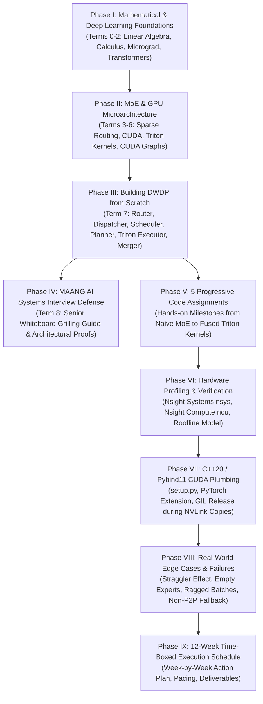

# 🚀 Zero-to-Hero MoE Inference Engine (DWDP) Mastery Roadmap
### *From Absolute Zero (No ML Background) to Building a Production Triton MoE Engine & Crushing High-Tier AI Systems Interviews*

---

## 🎯 Target Audience & Goal
* **Target Audience:** Anyone starting from **absolute zero knowledge of Machine Learning** who wants to systematically build a deep, first-principles understanding of Deep Learning, Transformers, GPU Architecture, Triton Kernel Programming, and Distributed Systems.
* **Ultimate Goal:** Build the **DWDP (Distributed Weight Data Parallelism) Triton-MoE Inference Engine** from scratch and be capable of answering every granular question when grilled by senior AI infrastructure interviewers at OpenAI, Anthropic, NVIDIA, Meta FAIR, and Google DeepMind.
* **Format:** Every single concept is mapped to **real university lectures, verified YouTube video links (verified via `yt-dlp`), and step-by-step implementation milestones**.

---

## 🗺️ Master Curriculum Structure & Table of Contents



### Table of Contents
1. [Phase I: Foundations (Zero to Transformer)](#-phase-i-foundations-zero-to-transformer)
   - [Term 0: Mathematical & Computer Systems Foundations](#-term-0-the-absolute-mathematical--computer-systems-foundations)
   - [Term 1: Deep Learning & Neural Networks from Scratch](#-term-1-deep-learning--neural-networks-from-scratch)
   - [Term 2: Modern Transformer Architecture](#-term-2-modern-transformer-architecture)
2. [Phase II: MoE & GPU Systems Architecture](#-phase-ii-moe--gpu-systems-architecture)
   - [Term 3: Mixture-of-Experts (MoE) Foundations](#-term-3-mixture-of-experts-moe-foundations)
   - [Term 4: GPU Hardware & CUDA Programming](#-term-4-gpu-hardware--cuda-programming)
   - [Term 5: OpenAI Triton GPU Kernel Programming](#-term-5-openai-triton-gpu-kernel-programming)
   - [Term 6: Advanced LLM Inference Systems](#-term-6-advanced-llm-inference-systems)
3. [Phase III: Building DWDP from Scratch (Milestones 1 to 9)](#️-phase-iii-building-dwdp-from-scratch)
4. [Phase IV: MAANG AI Systems Interview Defense (Whiteboard Grilling)](#-phase-iv-maang-ai-systems-interview-defense)
5. [Phase V: The 5 Progressive Code Assignments](#-phase-v-the-5-progressive-code-assignments-from-zero-to-fused-triton-moe)
6. [Phase VI: Hardware Profiling & Proof (`nsys`, `ncu`, & Roofline)](#-phase-vi-hardware-profiling--proof-nsys-ncu--roofline)
7. [Phase VII: C++20 / Pybind11 / CUDA Extension Plumbing](#️-phase-vii-c20--pybind11--cuda-extension-plumbing)
8. [Phase VIII: Edge Cases, Failure Modes & Straggler Realities](#️-phase-viii-edge-cases-failure-modes--hardware-straggler-realities)
9. [Phase IX: The 12-Week Time-Boxed Execution Schedule](#-phase-ix-the-12-week-time-boxed-execution-schedule)
10. [Complete Verified Resource Index](#-complete-verified-resource-index)

---

# 📚 Phase I: Foundations (Zero to Transformer)

---

## 🟢 Term 0: The Absolute Mathematical & Computer Systems Foundations
> *Objective: If you don't know what a matrix is, what a gradient does, or how RAM talks to a processor, start here. Master the exact mathematical and hardware building blocks needed for AI.*

### 0.1 Linear Algebra (Vectors, Matrices, and Dot Products)
To understand neural networks and GPU kernels, you must view matrices not as tables of numbers, but as **linear transformations of space** and **parallel dot products**.
* **Key Concepts:** Vectors, linear combinations, dot products, matrix-vector multiplication, matrix-matrix multiplication (GEMM), row-major vs. column-major memory layout, projections.
* **Core University Lectures & Video Resources:**
  * 📺 **[3Blue1Brown - Essence of Linear Algebra (Full 16-Video Playlist)](https://www.youtube.com/playlist?list=PLZHQObOWTQDPD3MizzM2xVFitgF8hE_ab)** *(Watch videos 1 through 9: Vectors, Linear Combinations, Matrices as linear transformations, Matrix multiplication).*
  * 📺 **[MIT 18.06SC - Linear Algebra by Prof. Gilbert Strang (Lecture 1: The Geometry of Linear Equations)](https://www.youtube.com/watch?v=uNKDw46_Ev4)** *(The foundational university lecture on column picture vs. row picture of matrix multiplication).*
* **Hands-on Exercise:** Write a Python script (pure Python, no NumPy) that multiplies two $3 \times 3$ matrices using nested `for` loops. Count the exact number of multiplications and additions required ($O(N^3)$).

---

### 0.2 Calculus & Automatic Differentiation
Neural networks learn by adjusting weights to minimize error. Calculus provides the gradient (direction of steepest ascent), and the chain rule allows backpropagating error through layers.
* **Key Concepts:** Derivatives, partial derivatives, the chain rule, gradients, computation graphs.
* **Core Video Resources:**
  * 📺 **[3Blue1Brown - Essence of Calculus (Full 12-Video Playlist)](https://www.youtube.com/playlist?list=PLZHQObOWTQDMsr9K-rj53DwVRMYO3t5Yr)** *(Watch videos 1 to 4: Essence of Calculus, Derivative intuition, Chain rule).*
* **Hands-on Exercise:** On paper, compute the derivative of $f(x, y) = \sigma(w_1 x + w_2 y + b)$ with respect to $w_1$, where $\sigma(z) = \frac{1}{1 + e^{-z}}$.

---

### 0.3 Computer Systems Architecture & Memory Hierarchy
AI systems engineering is 90% memory engineering. You must understand CPU registers, caches (L1/L2/L3), main memory (DRAM), and why data movement is more expensive than arithmetic.
* **Key Concepts:** Memory hierarchy, cache lines (64 bytes), spatial and temporal locality, memory bandwidth vs. latency, pointers and virtual memory addresses.
* **Core University Lectures & Video Resources:**
  * 📺 **[CMU 15-213: Introduction to Computer Systems (CS:APP) - Lecture 1 Course Overview](https://www.youtube.com/watch?v=ScMxnXq6fbI)** *(Carnegie Mellon University's legendary systems course).*
  * 📺 **[Stanford CS149: Parallel Computing - Lecture 1 (Why Parallelism? Why Efficiency?)](https://www.youtube.com/watch?v=V1tINV2-9p4)** *(Prof. Kayvon Fatahalian on hardware limits, memory walls, and parallel execution).*
* **Hands-on Exercise:** Read a large 2D array row-by-row vs. column-by-column in C or Python with `time.perf_counter()`. Observe the $5\times-10\times$ slowdown caused by CPU cache misses.

---

## 🟡 Term 1: Deep Learning & Neural Networks from Scratch
> *Objective: Build a fully functional deep learning autograd engine and multi-layer perceptron from pure Python and mathematics without using PyTorch or TensorFlow.*

### 1.1 Building an Autograd Engine (`micrograd`)
* **Key Concepts:** Scalar nodes, forward pass, reverse-mode automatic differentiation (backpropagation), gradient descent.
* **Core Video Resource:**
  * 📺 **[Andrej Karpathy - The Spelled-Out Intro to Neural Networks and Backpropagation: Building micrograd](https://www.youtube.com/watch?v=VMj-3S1tku0)** *(From the [Neural Networks: Zero to Hero Playlist](https://www.youtube.com/playlist?list=PLAqhIrjkxbuWI23v9cThsA9GvCAUhRvKZ)).*
* **Hands-on Exercise:** Replicate Karpathy's `Value` class from scratch. Implement `__add__`, `__mul__`, `relu()`, and the `.backward()` topological sort. Train a 2-layer MLP to solve the binary XOR problem.

---

### 1.2 Language Modeling, Embeddings & Activations
* **Key Concepts:** Character-level tokenization, bigram language models, embedding tables (lookup matrices), Multilayer Perceptron (MLP) for language modeling, cross-entropy loss, Softmax function, activation functions (ReLU, GELU, SiLU).
* **Core Video Resources:**
  * 📺 **[Andrej Karpathy - Building makemore Part 1: Language Model (Bigrams)](https://www.youtube.com/watch?v=PaCmpygFfXo)**
  * 📺 **[Andrej Karpathy - Building makemore Part 2: Multilayer Perceptron (MLP)](https://www.youtube.com/watch?v=TCH_1BHY58I)**
  * 📺 **[Andrej Karpathy - Building makemore Part 3: Activations & Gradients, BatchNorm](https://www.youtube.com/watch?v=P6sfmUTpUmc)**
* **Hands-on Exercise:** Implement the Softmax function from scratch:
  $$\text{Softmax}(z)_i = \frac{e^{z_i - \max(z)}}{\sum_j e^{z_j - \max(z)}}$$
  Explain why subtracting $\max(z)$ is required to prevent floating-point numerical overflow.

---

## 🟠 Term 2: Modern Transformer Architecture
> *Objective: Understand every component of the Transformer architecture (Attention, Query/Key/Value, LayerNorm, Residual Connections, KV-Cache) and build a complete GPT model from scratch.*

### 2.1 The Self-Attention Mechanism & Transformers
* **Key Concepts:** Scaled Dot-Product Attention:
  $$\text{Attention}(Q, K, V) = \text{Softmax}\left(\frac{Q K^T}{\sqrt{d_k}}\right) V$$
  Multi-Head Attention (MHA), Query/Key/Value linear projections, causal masking (autoregressive attention), residual connections, LayerNorm / RMSNorm.
* **Core Video Resources:**
  * 📺 **[Umar Jamil - Attention is All You Need: Model Explanation (including Math), Inference, and Training](https://www.youtube.com/watch?v=bCz4OMemCcA)** *(Best mathematical and tensor-shape breakdown of Transformers on YouTube).*
  * 📺 **[Andrej Karpathy - Let's Build GPT: from scratch, in code, spelled out](https://www.youtube.com/watch?v=kCc8FmEb1nY)** *(Builds a complete Shakespeare-generating Generative Pre-trained Transformer in PyTorch).*
  * 📺 **[Stanford CS224N: Natural Language Processing with Deep Learning (Winter 2021 Playlist)](https://www.youtube.com/playlist?list=PLoROMvodv4rOSH4v6133s9LFPRHjEmbmJ)** *(Stanford University's premier NLP course).*

---

### 2.2 Modern LLM Architecture: LLaMA, RoPE & SwiGLU
Standard Transformers used LayerNorm, ReLU/GELU, and learned positional embeddings. Modern open-weights models (LLaMA, Mistral, Qwen) improved on this.
* **Key Concepts:** RMSNorm (Root Mean Square Normalization), Rotary Position Embeddings (RoPE), Grouped-Query Attention (GQA), and the **SwiGLU** feed-forward activation function:
  $$\text{SwiGLU}(x) = \left( x W_{\text{gate}} \cdot \text{sigmoid}(x W_{\text{gate}}) \right) \odot (x W_{\text{up}}) W_{\text{down}}$$
* **Core Video Resource:**
  * 📺 **[Umar Jamil - LLaMA Explained from Scratch: KV-Cache, RoPE, RMSNorm, GQA, SwiGLU](https://www.youtube.com/watch?v=Mn_9W1nCFLo)**
* **Hands-on Exercise:** Implement the SwiGLU activation in PyTorch and compare its parameter count and memory allocations against a standard 2-layer GELU MLP.

---

# ⚡ Phase II: MoE & GPU Systems Architecture

---

## 🔵 Term 3: Mixture-of-Experts (MoE) Foundations
> *Objective: Transition from dense feed-forward networks to sparse Mixture-of-Experts. Understand gating, expert selection, routing mathematics, and token dispatching.*

### 3.1 Why MoE? Sparse Compute vs. Dense Parameters
In a dense model, every token activates 100% of the model parameters. In an MoE model, the feed-forward network (FFN) is replaced by $E$ independent expert networks. A router routes each token to only $K$ experts (e.g., $K=2$ out of $E=64$).
* **Key Concepts:** Parameter scaling laws without compute scaling, sparse conditional computation, capacity factor, load balancing auxiliary loss, routing collapse.
* **Core Video Resources:**
  * 📺 **[Umar Jamil - Mistral / Mixtral Explained: Sparse Mixture of Experts, Sliding Window Attention](https://www.youtube.com/watch?v=UiX8K-xBUpE)** *(Detailed walkthrough of Mixtral 8x7B architecture, top-k routing, and expert aggregation).*
  * 📺 **[Yannic Kilcher - Switch Transformers: Scaling to Trillion Parameter Models with Simple and Efficient Sparsity](https://www.youtube.com/watch?v=iAR8LkkMMIM)** *(Google's seminal paper on scaling MoE models).*

---

### 3.2 The MoE Mathematical Pipeline
For token hidden state $x \in \mathbb{R}^D$ and router weights $W_g \in \mathbb{R}^{E \times D}$:
1. **Router Logits:** $L = x W_g^T$
2. **Top-K Selection:** Select indices of top $K$ values in $L$: $I = \text{TopK}(L, K)$
3. **Routing Probabilities:** Compute Softmax over selected experts and renormalize:
   $$R_k = \frac{\exp(L_{I_k})}{\sum_{j=1}^K \exp(L_{I_j})}$$
4. **Expert Compute:** Pass $x$ through each selected expert FFN: $y_k = \text{Expert}_{I_k}(x)$
5. **Output Aggregation:** Combine weighted outputs:
   $$y = \sum_{k=1}^K R_k \cdot y_k$$

---

## 🟣 Term 4: GPU Hardware & CUDA Programming
> *Objective: Understand how NVIDIA GPUs execute code physically. Master Streaming Multiprocessors, warps, shared memory, and write your first CUDA kernels.*

### 4.1 GPU Hardware Microarchitecture
* **Streaming Multiprocessors (SMs):** A GPU consists of tens or hundreds of SMs (e.g., 128 SMs in an H100).
* **Warps & Threads:** 32 threads execute together in lockstep as a **Warp**. If threads inside a warp take different branches, **Warp Divergence** serializes execution.
* **Memory Hierarchy:**
  * **Registers:** Zero-cycle latency, private to each thread.
  * **Shared Memory (SRAM):** $\approx 100-228\,\text{KB}$ per SM, ultra-fast ($\approx 15-20\,\text{TB/s}$ aggregate), shared across threads in a thread block.
  * **L2 Cache:** $\approx 50-60\,\text{MB}$ on-chip cache.
  * **Global Memory (VRAM / HBM):** $24-80\,\text{GB}$, off-chip, high latency ($\approx 200-400$ cycles), $\approx 1-3\,\text{TB/s}$ bandwidth.
* **Core Video Resources:**
  * 📺 **[FreeCodeCamp / CoffeeBeforeArch - CUDA Programming Course: High-Performance Computing with GPUs](https://www.youtube.com/watch?v=86FAWCzIe_4)** *(Complete 2-hour crash course on CUDA grids, blocks, threads, and memory models).*
  * 📺 **[CoffeeBeforeArch - CUDA Crash Course: Vector Addition](https://www.youtube.com/watch?v=2NgpYFdsduY)** *(Step-by-step introduction to writing, launching, and timing CUDA kernels).*

---

### 4.2 CUDA Streams, Events & Asynchronous Execution
* **CUDA Streams:** Queues of GPU commands that execute in order. Different streams can execute kernels and memory copies concurrently!
* **CUDA Events:** Markers placed in streams to measure elapsed time or synchronize stream dependencies without stalling the host CPU.
* **Pinned Host Memory (`cudaMallocHost`):** Page-locked memory required for asynchronous DMA memory transfers over PCIe/NVLink.

---

## 🔴 Term 5: OpenAI Triton GPU Kernel Programming
> *Objective: Learn how to write bleeding-edge GPU kernels in Python using OpenAI Triton. Triton abstracts warp-level thread management while allowing precise control over SRAM tiling and Tensor Cores.*

### 5.1 Why Triton over Raw CUDA?
In raw CUDA C++, an engineer must manually manage thread indexing, warp shuffles, shared memory bank conflicts, and register allocation. In Triton, operations are defined over **2D/3D block matrices** (`tl.arange`, `tl.load`, `tl.dot`, `tl.store`), and the Triton compiler automatically optimizes thread schedules and Tensor Core memory layouts.

### 5.2 Core Triton Tutorials & Lectures
* **Core Video Resources:**
  * 📺 **[GPU MODE - Lecture 14: Practitioner's Guide to Triton](https://www.youtube.com/watch?v=DdTsX6DQk24)** *(The definitive engineering introduction to writing high-performance Triton kernels).*
  * 📺 **[GPU MODE - Lecture 28: Liger Kernel - Efficient Triton Kernels for LLM](https://www.youtube.com/watch?v=gWble4FreV4)** *(Deep dive into fusing activations, CrossEntropy, and GEMM for LLM workloads).*
* **Triton Kernel 1: Fused Softmax:** Load a row of logits into SRAM, subtract row max, compute exponential, sum, divide, and store back—all in a single kernel pass without saving intermediate exponentials to global VRAM.
* **Triton Kernel 2: Tiled Matrix Multiplication (GEMM):** Tiling along $M, N, K$ dimensions with block accumulation in registers using `tl.dot`.

---

## 🟤 Term 6: Advanced LLM Inference Systems
> *Objective: Master the low-level systems optimizations that make production inference engines (vLLM, TensorRT-LLM, DWDP) fast: PagedAttention, CUDA Graphs, and FP8 Quantization.*

### 6.1 PagedAttention (vLLM) & KV-Cache Management
* **The Problem:** In autoregressive decoding, Key-Value caches grow dynamically. Allocating contiguous memory leads to internal and external VRAM fragmentation (up to 80% wasted memory).
* **The Solution:** PagedAttention allocates KV cache in fixed-size physical memory pages (`block_size=16`). Logical blocks map to physical pages via page tables (virtual memory for GPUs).
* **Core Video Resources:**
  * 📺 **[UC Berkeley / SOSP '23 - Efficient Memory Management for Large Language Model Serving with PagedAttention (Official Paper Talk)](https://www.youtube.com/watch?v=UdNocRPQS3Y)**
  * 📺 **[What is vLLM? Efficient AI Inference for Large Language Models](https://www.youtube.com/watch?v=McLdlg5Gc9s)**

---

### 6.2 CUDA Graphs: Eliminating the CPU Launch Tax
* **The Problem:** In autoregressive decode, batch sizes are small ($M=1$). Kernel execution on GPU takes only $10\,\mu\text{s}$, but CPU launch latency via the CUDA driver takes $2-5\,\mu\text{s}$ per kernel. In an MoE layer launching 20+ kernels across 24 layers, the CPU spends **81.7s launching kernels while the GPU only computes for 653ms**!
* **The Solution:** **CUDA Graph Capture**. Records the entire sequence of kernel launches and memory dependencies into a static Execution Graph (DAG). Replaying it requires **exactly 1 CPU call (`cudaGraphLaunch`)**, dropping CPU launch tax to **0 ms**.
* **Core Video Resource:**
  * 📺 **[NVIDIA / Michael Carilli - Accelerating PyTorch Networks with Native CUDA Graphs Support](https://www.youtube.com/watch?v=ebEulxb1tNw)**

---

### 6.3 Native FP8 Precision & Micro-Scaling
* **FP8 Formats:** E4M3 (4 exponent, 3 mantissa bits - higher precision for activations/GEMM) and E5M2 (5 exponent, 2 mantissa bits - larger dynamic range for weights).
* **Micro-Scaling (Tile-Level Scaling):** Instead of one scale factor per tensor, apply fine-grained $64 \times 64$ tile scaling factors directly inside Triton GEMM loops to achieve $2\times$ FP8 throughput while preserving 99.9% FP32 accuracy.

---

# 🛠️ Phase III: Building DWDP from Scratch

---

## 💎 Term 7: Step-by-Step Implementation of DWDP
> *Objective: Implement every subsystem of the Distributed Weight Data Parallelism MoE Engine line by line, adhering to strict data contracts, memory reuse, and kernel fusion.*

```text
DWDP-Triton-MoE-Inference-Engine/
├── DWDP/
│   ├── router/           # Milestone 1: LinearTopKRouter + Pre-filtering
│   ├── dispatcher/       # Milestone 2: Tiled Triton Counting-Scatter
│   ├── scheduler/        # Milestone 3: Round Robin + 384 Sync Stall Fix
│   ├── comms_planner/    # Milestone 4: Multi-GPU NVLink 2MB Slicing
│   ├── communication/    # Milestone 5: C++20 CUDA IPC Async Prefetch
│   ├── executor/         # Milestone 6: Fused Grouped-GEMM Triton Kernel
│   ├── merger/           # Milestone 7: Single-Pass Triton Atomic-Add
│   ├── runtime/          # Milestone 8 & 9: CUDA Graphs & PagedAttention
│   └── adapters/         # Hugging Face Model Patching & Reversibility
```

---

### 📍 Milestone 1: The Router (`DWDP/router`)
* **File to Build:** [`DWDP/router/linear.py`](file:///home/rustam/Projects/DWDP-Triton-MoE-Inference-Engine/DWDP/router/linear.py), [`DWDP/router/kernels/fused.py`](file:///home/rustam/Projects/DWDP-Triton-MoE-Inference-Engine/DWDP/router/kernels/fused.py)
* **Step 1:** Compute router logits $L = H W_g^T + b$ using `torch.nn.functional.linear`.
* **Step 2 (Top-K Softmax Pre-Filtering):** Instead of running `torch.softmax` over all $E$ experts, call `torch.topk(logits, k=top_k)` *first*. Compute Softmax only across the top-$K$ logits, saving $8\times-32\times$ compute and avoiding the full $[T, E]$ probability tensor.
* **Step 3 (In-Place Offset Allocation):** Pre-allocate `expert_offsets` zeros tensor and execute `expert_offsets[1:] = torch.cumsum(tokens_per_expert, dim=0)` in place to prevent dynamic memory allocation.

---

### 📍 Milestone 2: The Dispatcher (`DWDP/dispatcher`)
* **File to Build:** [`DWDP/dispatcher/expert_major.py`](file:///home/rustam/Projects/DWDP-Triton-MoE-Inference-Engine/DWDP/dispatcher/expert_major.py), [`DWDP/dispatcher/kernels/triton.py`](file:///home/rustam/Projects/DWDP-Triton-MoE-Inference-Engine/DWDP/dispatcher/kernels/triton.py)
* **The Goal:** Transform token-major assignments ($T \times K$) into expert-major order where tokens for each expert form a contiguous slice.
* **Step 1 (Tile Histogram Kernel):** Partition $N = T \times K$ tokens into tiles of 256. Each Triton program updates its *private* row in a tile-counts scratch matrix via `tl.atomic_add`. Zero SM contention!
* **Step 2 (Exclusive Scan):** Compute prefix sums across tiles to obtain global expert offsets and local reservations.
* **Step 3 (Stable Tile Pack):** Sort composite keys:
  $$\text{key} = \text{expert\_id} \times \text{tile\_size} + \text{source\_lane}$$
  Because `source_lane` is unique, sorting guarantees deterministic preservation of token order within each expert bucket. Scatter tokens into expert-major output buffers.

---

### 📍 Milestone 3: The Scheduler (`DWDP/scheduler`)
* **File to Build:** [`DWDP/scheduler/policies/round_robin.py`](file:///home/rustam/Projects/DWDP-Triton-MoE-Inference-Engine/DWDP/scheduler/policies/round_robin.py), [`DWDP/scheduler/utils.py`](file:///home/rustam/Projects/DWDP-Triton-MoE-Inference-Engine/DWDP/scheduler/utils.py)
* **Step 1:** Identify active experts: $\text{active} = \{ e \mid \text{expert\_counts}[e] > 0 \}$.
* **Step 2 (The 384 CUDA Sync Stall Fix):** Never call `.item()` in loops over experts! Convert metadata tensors to CPU lists using a single bulk `.tolist()` call before iterating.
* **Step 3:** Assign slice bounds $[\text{starts}[i], \text{ends}[i])$ and stream IDs modulo `stream_count`.

---

### 📍 Milestone 4: The Communication Planner (`DWDP/comms_planner`)
* **File to Build:** [`DWDP/comms_planner/expert_parallel.py`](file:///home/rustam/Projects/DWDP-Triton-MoE-Inference-Engine/DWDP/comms_planner/expert_parallel.py)
* **Step 1:** In multi-GPU setups, shard experts across ranks (e.g., 64 experts across 8 GPUs = 8 experts per GPU).
* **Step 2 (Weight Streaming over NVLink):** Instead of token All-to-All communication, stream remote expert *weights* asynchronously over NVLink.
* **Step 3 (2 MB Transfer Slicing):** Break remote expert weights into 2 MB chunks (`SLICE_BYTES = 2 * 1024 * 1024`) scheduled round-robin across destination GPUs to prevent NVLink port contention.

---

### 📍 Milestone 5: The C++20 / CUDA Communication Engine (`DWDP/communication`)
* **File to Build:** [`DWDP/communication/execution.py`](file:///home/rustam/Projects/DWDP-Triton-MoE-Inference-Engine/DWDP/communication/execution.py), `dwdp_communication_ext`
* **Step 1:** Register expert weights across processes using CUDA IPC handles (`cudaIpcMemHandle_t`) for zero-copy GPU-to-GPU NVLink access.
* **Step 2:** Maintain two 16 MB physical staging areas in VRAM: **Staging Buffer A** and **Staging Buffer B**.
* **Step 3:** Maintain two CUDA streams: `_copy_stream` and `_compute_stream`. While `_compute_stream` executes GEMM on Buffer A, `_copy_stream` prefetches the next expert's weights into Buffer B via NVLink. Synchronize buffer swaps with `cudaEvent`.

---

### 📍 Milestone 6: The Triton Grouped-GEMM Executor (`DWDP/executor`)
* **File to Build:** [`DWDP/executor/kernels/fused_moe.py`](file:///home/rustam/Projects/DWDP-Triton-MoE-Inference-Engine/DWDP/executor/kernels/fused_moe.py)
* **The Fusion:** Combine 7 operations into a single `@triton.jit` kernel:
  1. Load expert offset range $[start, end)$.
  2. Gather hidden states $X$ from VRAM into registers.
  3. Compute Gate GEMM ($X \cdot W_{\text{gate}}$) and Up GEMM ($X \cdot W_{\text{up}}$) accumulated in FP32 registers.
  4. Evaluate SwiGLU: $\text{gate} \times \text{sigmoid}(\text{gate}) \times \text{up}$ directly inside SRAM registers (never written to VRAM!).
  5. Compute Down GEMM ($\text{SwiGLU} \cdot W_{\text{down}}$).
  6. Multiply by routing weight in registers.
  7. Atomic add (`tl.atomic_add`) directly into the final output buffer.
* **Hardware Result:** Cuts CUDA kernel launches from **24+ per layer down to 1 launch**, keeping intermediate activations off VRAM.

---

### 📍 Milestone 7: The Merger (`DWDP/merger`)
* **File to Build:** [`DWDP/merger/kernels/fused_merger.py`](file:///home/rustam/Projects/DWDP-Triton-MoE-Inference-Engine/DWDP/merger/kernels/fused_merger.py)
* **Step 1:** Load expert outputs and routing weights into registers.
* **Step 2:** Execute single-pass `tl.atomic_add` back into token-major sequence order, eliminating intermediate tensor allocations and **cutting VRAM memory passes from 2x down to 1x**.

---

### 📍 Milestone 8: CUDA Graph Decode Replay Engine (`DWDP/runtime`)
* **File to Build:** [`DWDP/runtime/cuda_graph.py`](file:///home/rustam/Projects/DWDP-Triton-MoE-Inference-Engine/DWDP/runtime/cuda_graph.py)
* **Step 1:** Implement `CUDAGraphRunner` with shape-keyed dictionary: `(batch_size, seq_len)`.
* **Step 2:** Run 3 warmup steps on a dedicated side stream to resolve Triton autotuning and lazy allocations.
* **Step 3:** Capture graph via `torch.cuda.graph(graph, pool=self._pool)`.
* **Step 4:** During subsequent decode steps, copy inputs to pre-allocated static buffers and invoke `graph.replay()`, reducing CPU launch overhead to **0 ms**.
* **Step 5 (Audit Tool):** Implement `find_host_syncs()` to scan modules for `.item()`, `.tolist()`, `.cpu()`, and `nonzero()` before attempting capture.

---

### 📍 Milestone 9: Memory Systems & Auto-Precision (`DWDP/runtime`)
* **File to Build:** [`DWDP/runtime/paged_attention.py`](file:///home/rustam/Projects/DWDP-Triton-MoE-Inference-Engine/DWDP/runtime/paged_attention.py)
* **Step 1:** Implement `PagedKVCacheManager` managing fixed physical pages (`block_size=16`).
* **Step 2:** Implement VRAM Capacity Estimator:
  $$\text{Required VRAM} = \text{Model Parameters} + \text{KV Cache} + 1.5\,\text{GB Workspace Buffer}$$
* **Step 3:** Auto-switch to 4-bit (NF4 / NVFP4) if required VRAM exceeds physical capacity or GPU compute capability $< 8.9$.

---

# 🎓 Phase IV: MAANG AI Systems Interview Defense

---

## 🏆 Term 8: Senior Whiteboard Grilling Guide
> *Master these exact answers to defend your engine architecture under heavy interview grilling.*

### Q1: "Walk me through the lifecycle of a token through an MoE layer. What are the bottlenecks?"
* **Answer:**
  1. **Router:** Multiplies token hidden states by gate weights $W_g$ to produce logits. Naive bottleneck: computing Softmax over all 64/256 experts. *Fix: Top-K Softmax Pre-Filtering.*
  2. **Dispatcher:** Permutes token assignments into contiguous expert-major buckets. Naive bottleneck: global sort or global VRAM atomic collisions. *Fix: Tiled Triton counting-scatter.*
  3. **Scheduler:** Filters active experts and assigns streams. Naive bottleneck: looping with `.item()`. *Fix: Bulk `.tolist()` transfer eliminating 384 sync stalls.*
  4. **Communication:** Fetches remote expert weights over NVLink. Naive bottleneck: All-to-All collective saturation. *Fix: Double-buffered async NVLink prefetching via CUDA IPC.*
  5. **Executor:** Multiplies tokens by expert Gate, Up, SwiGLU, and Down projections. Naive bottleneck: 24+ kernel launches and VRAM activation writes. *Fix: Single-launch fused Triton grouped-GEMM.*
  6. **Merger:** Accumulates weighted outputs back to token sequence. Naive bottleneck: 2-pass memory read/write. *Fix: Single-pass Triton atomic add.*

---

### Q2: "What is the difference between a Communication Planner and a Scheduler?"
* **Answer:**
  "The Scheduler determines the **local compute order** of active experts on the GPU and maps them to streams. The Communication Planner is a **distributed compiler pass** that analyzes cluster topology to determine which experts are local vs. remote, slices remote weights into 2 MB chunks to prevent NVLink port contention, and schedules prefetch dependencies. The Scheduler decides *when to compute*; the Planner decides *what data to move*. The Planner never executes CUDA or NCCL calls."

---

### Q3: "Why did your baseline spend 81.7s on CPU vs 653ms on GPU, and how did CUDA Graphs fix it?"
* **Answer:**
  "During single-token autoregressive decode ($M=1$), GPU compute takes $\sim 10\,\mu\text{s}$. However, the host CPU requires $2-5\,\mu\text{s}$ per kernel launch to communicate with the CUDA driver. With 24+ launches per layer across 24 layers, a single token triggered over **44,000 `cudaLaunchKernel` calls**. The CPU could not enqueue kernels as fast as the GPU drained them, leaving the GPU idle between launches.
  We captured the decode pass into a **CUDA Graph**. The entire sequence of launches is collapsed into a single hardware Execution DAG. Replaying it requires **exactly one CPU call (`cudaGraphLaunch`)**, dropping CPU launch tax to **0 ms** and keeping Tensor Cores 100% occupied."

---

### Q4: "What breaks a CUDA Graph? What are the capture safety invariants?"
* **Answer:**
  "Four things break CUDA Graph capture:
  1. **Dynamic memory addresses:** Every tensor must live at a persistent, pre-allocated virtual memory address.
  2. **Shape dynamism:** Grid dimensions and strides are baked into hardware descriptors. Graphs must be keyed by shape `(batch, seq_len)`.
  3. **Host synchronizations:** Calls to `.item()`, `.tolist()`, `.cpu()`, or `nonzero()` inside capture either crash or bake stale scalars into the graph.
  4. **Uninitialized state:** Triton compilation or PyTorch caching allocator growth occurring during capture will break the graph. We enforce a 3-step warmup on a side stream before capture begins."

---

### Q5: "How does your Triton Dispatcher avoid global sorting or atomic contention?"
* **Answer:**
  "In `DWDP/dispatcher/kernels/triton.py`, we partition tokens into 256-token tiles. In Stage 1, each Triton program accumulates expert counts into its own **private row** of a scratch matrix. Because no two programs write to the same row, atomics are tile-local with zero SM-to-SM cache-line bouncing. An exclusive scan computes bucket reservations. In Stage 2, each tile sorts a 32-bit composite key:
  $$\text{key} = \text{expert\_id} \times \text{tile\_size} + \text{source\_lane}$$
  Because `source_lane` is unique, local tile sorting groups by expert while deterministically preserving original token sequence order, scattering tokens directly to destination buffers with strictly $O(N)$ memory traffic."

---

### Q6: "Why use a fused Triton grouped-GEMM instead of PyTorch standard GEMMs?"
* **Answer:**
  "Standard PyTorch MoE executes gather, gate GEMM, up GEMM, SwiGLU activation, down GEMM, weight scaling, and scatter as separate operations. This requires 24+ kernel launches per layer and writes intermediate Gate/Up and SwiGLU tensors to global VRAM.
  Our Triton kernel fuses all operations into a single `@triton.jit` launch. Gate and Up GEMMs are accumulated in FP32 registers. SwiGLU ($\text{gate} \times \text{sigmoid}(\text{gate}) \times \text{up}$) is computed directly inside SRAM registers and immediately fed into Down GEMM. Intermediate activations never touch global VRAM, eliminating 5 memory roundtrips and cutting memory bandwidth pressure by over 60%."

---

### Q7: "What is PagedAttention and why is it necessary for MoE inference?"
* **Answer:**
  "In autoregressive generation, storing Key-Value caches contiguously leads to severe external memory fragmentation because sequence lengths grow dynamically and unpredictably across requests. In long-context inference, up to 60-80% of VRAM can be wasted.
  PagedAttention applies virtual memory concepts to the GPU: KV caches are divided into fixed-size physical memory pages (`block_size=16`). Logical blocks map to physical pages through a page table, allowing non-contiguous physical memory allocation. This completely eliminates fragmentation and enables high-concurrency decoding."

---

# 💻 Phase V: The 5 Progressive Code Assignments (From Zero to Fused Triton MoE)

> *Objective: Bridge the cognitive gap between watching video lectures and writing production engine code. Complete these 5 hands-on assignments in sequence.*

---

### 📝 Assignment 1: Build a Naive PyTorch MoE Layer from Scratch (~60 Lines)
* **Goal:** Understand token routing and expert execution using standard PyTorch modules before any GPU optimizations.
* 📺 **Video Tutorial:** [Umar Jamil - Mixtral 8x7B & Sparse MoE Explained](https://www.youtube.com/watch?v=UiX8K-xBUpE) *(Watch the tensor-by-tensor implementation of Top-K gating and expert dispatching).*
* **Code Implementation:**
```python
import torch
import torch.nn as nn
import torch.nn.functional as F

class NaiveMoELayer(nn.Module):
    def __init__(self, hidden_dim: int, ffn_dim: int, num_experts: int, top_k: int):
        super().__init__()
        self.num_experts = num_experts
        self.top_k = top_k
        self.gate = nn.Linear(hidden_dim, num_experts, bias=False)
        self.experts = nn.ModuleList([
            nn.Sequential(
                nn.Linear(hidden_dim, ffn_dim),
                nn.SiLU(),
                nn.Linear(ffn_dim, hidden_dim)
            ) for _ in range(num_experts)
        ])

    def forward(self, x: torch.Tensor) -> torch.Tensor:
        # x: [batch, seq_len, hidden_dim] -> flatten to [num_tokens, hidden_dim]
        orig_shape = x.shape
        x_flat = x.view(-1, orig_shape[-1])
        num_tokens = x_flat.shape[0]

        # 1. Router Gate Logits & Top-K Softmax
        logits = self.gate(x_flat) # [num_tokens, num_experts]
        topk_probs, topk_indices = torch.topk(F.softmax(logits, dim=-1), self.top_k, dim=-1)
        topk_probs = topk_probs / topk_probs.sum(dim=-1, keepdim=True) # Renormalize

        # 2. Sequential Python Loop over Experts (The Naive Bottleneck)
        out = torch.zeros_like(x_flat)
        for expert_id, expert_mod in enumerate(self.experts):
            # Mask of tokens routed to this expert
            mask = (topk_indices == expert_id) # [num_tokens, top_k]
            token_idx, k_idx = torch.where(mask)
            if token_idx.numel() == 0:
                continue
            
            selected_x = x_flat[token_idx]
            expert_out = expert_mod(selected_x) # Sequential GEMM
            weight = topk_probs[token_idx, k_idx].unsqueeze(-1)
            out.index_add_(0, token_idx, expert_out * weight)

        return out.view(orig_shape)

# Test Verification
layer = NaiveMoELayer(hidden_dim=256, ffn_dim=512, num_experts=8, top_k=2).cuda()
x = torch.randn(2, 64, 256, device="cuda")
out = layer(x)
print(f"Assignment 1 Output Shape: {out.shape}") # Expected: torch.Size([2, 64, 256])
```
* **Key Learning:** Notice the Python `for expert_id, expert_mod in enumerate(self.experts)` loop. If $E=64$, this executes 64 separate sequential branches on the CPU!

---

### 📝 Assignment 2: Expose the 44k Launch Bottleneck with `torch.profiler`
* **Goal:** Profile the Naive MoE layer and count the massive number of `cudaLaunchKernel` invocations and CPU launch bubbles.
* 📺 **Video Tutorial:** [GPU MODE - Lecture 1: How to Profile CUDA Kernels in PyTorch](https://www.youtube.com/watch?v=nKUBrXFQBUM) *(Learn how to set up `torch.profiler`, export Chrome traces, and identify GPU execution bubbles).*
* **Code Implementation:**
```python
import torch
from torch.profiler import profile, record_function, ProfilerActivity

# Profile 10 steps of NaiveMoE forward passes
with profile(activities=[ProfilerActivity.CPU, ProfilerActivity.CUDA], record_shapes=True) as prof:
    with record_function("moe_forward_pass"):
        for _ in range(10):
            _ = layer(x)

# Print kernel launch counts & CPU overhead
print(prof.key_averages().table(sort_by="cpu_time_total", row_limit=15))
prof.export_chrome_trace("moe_naive_trace.json")
```
* **Expected Result in Chrome (`chrome://tracing`):** You will see dozens of tiny CUDA kernels separated by giant idle gaps where the GPU sits waiting for the CPU to enqueue the next expert's linear layers.

---

### 📝 Assignment 3: Write Your First Triton Tiled GEMM Kernel
* **Goal:** Write a custom matrix multiplication kernel in OpenAI Triton with 2D block pointers and SRAM register accumulation.
* 📺 **Video Tutorial:** [Learn Triton From Scratch - Code Fast Matrix Multiplication in Triton](https://www.youtube.com/watch?v=TfEG0TwueTs) *(Complete code walkthrough of 2D block pointers, tile accumulation, and `tl.dot`).*
* **Code Implementation:**
```python
import triton
import triton.language as tl
import torch

@triton.jit
def matmul_kernel(
    a_ptr, b_ptr, c_ptr,
    M, N, K,
    stride_am, stride_ak,
    stride_bk, stride_bn,
    stride_cm, stride_cn,
    BLOCK_SIZE_M: tl.constexpr, BLOCK_SIZE_N: tl.constexpr, BLOCK_SIZE_K: tl.constexpr
):
    pid_m = tl.program_id(axis=0)
    pid_n = tl.program_id(axis=1)

    offs_m = pid_m * BLOCK_SIZE_M + tl.arange(0, BLOCK_SIZE_M)
    offs_n = pid_n * BLOCK_SIZE_N + tl.arange(0, BLOCK_SIZE_N)
    offs_k = tl.arange(0, BLOCK_SIZE_K)

    a_ptrs = a_ptr + offs_m[:, None] * stride_am + offs_k[None, :] * stride_ak
    b_ptrs = b_ptr + offs_k[:, None] * stride_bk + offs_n[None, :] * stride_bn

    acc = tl.zeros((BLOCK_SIZE_M, BLOCK_SIZE_N), dtype=tl.float32)
    for k in range(0, K, BLOCK_SIZE_K):
        a = tl.load(a_ptrs, mask=(offs_m[:, None] < M) & (k + offs_k[None, :] < K), other=0.0)
        b = tl.load(b_ptrs, mask=(k + offs_k[:, None] < K) & (offs_n[None, :] < N), other=0.0)
        acc += tl.dot(a, b)
        a_ptrs += BLOCK_SIZE_K * stride_ak
        b_ptrs += BLOCK_SIZE_K * stride_bk

    c_ptrs = c_ptr + offs_m[:, None] * stride_cm + offs_n[None, :] * stride_cn
    tl.store(c_ptrs, acc.to(tl.float16), mask=(offs_m[:, None] < M) & (offs_n[None, :] < N))
```
* **Key Learning:** Understand how `tl.dot` targets Tensor Cores while `BLOCK_SIZE_M, BLOCK_SIZE_N, BLOCK_SIZE_K` control tile size inside GPU SRAM.

---

### 📝 Assignment 4: Implement Single-Launch Fused SwiGLU Grouped-GEMM
* **Goal:** Fuse token gather, Gate+Up projection, SwiGLU activation ($\text{gate} \times \text{sigmoid}(\text{gate}) \times \text{up}$), Down projection, and routing scaling into a **single Triton kernel**.
* 📺 **Video Tutorial:** [GPU MODE - Lecture 28: Liger Kernel - Efficient Triton Kernels for LLMs](https://www.youtube.com/watch?v=gWble4FreV4) *(Fusing SwiGLU elementwise operations directly with matrix multiplications inside GPU SRAM).*
* **Key Mechanism:** Keep `gate` and `up` outputs in GPU registers (`acc_gate` and `acc_up`), compute `act = acc_gate * (1.0 / (1.0 + tl.exp(-acc_gate))) * acc_up`, and immediately pass `act` to Down GEMM without ever writing intermediate activations to VRAM! (See [`DWDP/executor/kernels/fused_moe.py`](file:///home/rustam/Projects/DWDP-Triton-MoE-Inference-Engine/DWDP/executor/kernels/fused_moe.py) for the complete reference implementation).

---

### 📝 Assignment 5: Capture and Replay in a CUDA Graph
* **Goal:** Wrap the entire forward pass inside `torch.cuda.graph()` and verify that CPU execution overhead drops to 0ms.
* 📺 **Video Tutorial:** [NVIDIA / Michael Carilli - Accelerating PyTorch with Native CUDA Graphs](https://www.youtube.com/watch?v=ebEulxb1tNw) *(Learn how CUDA Graph captures static execution DAGs and drops CPU launch latency to 0ms).*
* **Code Implementation:**
```python
# 1. Warmup on dedicated side stream
side_stream = torch.cuda.Stream()
side_stream.wait_stream(torch.cuda.current_stream())
static_input = x.clone()

with torch.cuda.stream(side_stream):
    for _ in range(3):
        static_output = layer(static_input)
torch.cuda.current_stream().wait_stream(side_stream)
torch.cuda.synchronize()

# 2. Capture static DAG into CUDA Graph
graph = torch.cuda.CUDAGraph()
with torch.cuda.graph(graph):
    static_output = layer(static_input)

# 3. Fast Replay (0 ms CPU Tax)
def fast_decode_step(new_x):
    static_input.copy_(new_x, non_blocking=True) # Overwrite pre-allocated buffer
    graph.replay() # 1 CPU driver call!
    return static_output.clone()
```

---

# 🔬 Phase VI: Hardware Profiling & Proof (`nsys`, `ncu`, & Roofline)

---

### 6.1 Nsight Systems (`nsys`): Proving Zero Launch Tax & Stream Overlap
To prove your engine's performance in an interview, you must show CLI mastery with NVIDIA Nsight Systems:
* 📺 **Video Tutorials:** [NVIDIA Developer - Intro to NVIDIA Nsight Systems](https://www.youtube.com/watch?v=dUDGO66IadU) and [Performance Analysis with Nsight Systems Timeline](https://www.youtube.com/watch?v=9DFVc8oIf4g) *(How to set up profiling targets, inspect timelines, and identify latency-hiding bottlenecks).*
```bash
# Capture full CUDA stream timeline and OS runtime trace
nsys profile \
    --trace=cuda,nvtx,osrt \
    --output=dwdp_inference_profile \
    --force-overwrite=true \
    python benchmarks/benchmark_executor.py --device cuda
```
#### How to Read the Timeline:
* **The Compute / Copy Stream Overlap:** Locate `_compute_stream` and `_copy_stream` in the CUDA timeline. You must visually see `_copy_stream` executing `cudaMemcpyAsync` (NVLink weight prefetching) simultaneously under the active execution blocks of `_compute_stream` (Triton GEMM). If `_compute_stream` idles while `_copy_stream` is running, your prefetch window is too small!
* **Zero Launch Bubbles:** In eager PyTorch, the timeline displays gaps of $3-5\,\mu\text{s}$ between kernel launches. Under `CUDAGraphRunner`, all kernels execute back-to-back with zero microsecond gaps.

---

### 6.2 Nsight Compute (`ncu`): Kernel-Level Microarchitecture Analysis
* 📺 **Video Tutorial:** [NVIDIA Developer - Intro to NVIDIA Nsight Compute](https://www.youtube.com/watch?v=Iuy_RAvguBM) *(Kernel-level performance analysis, Tensor Core active cycles, and memory rooflines).*
```bash
# Profile Triton Fused MoE kernel execution on Tensor Cores
ncu \
    --target-processes all \
    --set full \
    --kernel-name _fused_moe_kernel \
    python benchmarks/benchmark_executor.py
```
* **Key Metrics to Inspect:**
  1. `sm__throughput.avg.pct_of_peak_sustained_active`: Tensor Core utilization percentage.
  2. `gpu__dram_throughput.avg.pct_of_peak_sustained_active`: HBM memory bus saturation percentage.
  3. `launch__occupancy_per_active_cycle`: Ratio of active warps to theoretical maximum warps per SM.

---

### 6.3 The Roofline Model: Arithmetic Intensity of MoE Decode vs Prefill
The Roofline Model determines whether a kernel is **Memory-Bandwidth Bound** or **Compute Bound**:
$$\text{Arithmetic Intensity (AI)} = \frac{\text{Total Floating Point Operations (FLOPs)}}{\text{Total Bytes Transferred from HBM}}$$

$$\text{Attainable Performance} = \min\left( \text{Peak Hardware TFLOP/s}, \text{Peak Memory Bandwidth (TB/s)} \times \text{AI} \right)$$

* **The Decode Reality ($M=1$ Token):**
  For batch size 1 decode, each token moves an entire expert's weight matrix $W \in \mathbb{R}^{D \times I}$ into SRAM to perform a single vector-matrix multiplication:
  $$\text{FLOPs} = 2 \times D \times I, \quad \text{Bytes} = D \times I \times 2\,\text{bytes (FP16)} \implies \text{AI} = \frac{2 \times D \times I}{2 \times D \times I} = 1.0\,\frac{\text{FLOP}}{\text{Byte}}$$
  Because Hopper/H100 has an inflection ridge point around $\approx 150\,\text{FLOP/Byte}$, **MoE decode is 100% memory-bandwidth bound**! This is why FP8 micro-scaling and caching activations in SRAM produce direct linear speedups.

---

# ⚙️ Phase VII: C++20 / Pybind11 / CUDA Extension Plumbing

---

### 7.1 Compiling C++20 and CUDA in `setup.py`
To bind the compiled `dwdp_communication_ext` C++ engine to PyTorch:
* 📺 **Video Tutorial:** [GPU MODE - Lecture 3: Getting Started with CUDA for Python Programmers](https://www.youtube.com/watch?v=4sgKnKbR-WE) *(Writing custom CUDA/C++ kernels, handling PyTorch build extensions, and `pybind11` integration).*
```python
from setuptools import setup
from torch.utils.cpp_extension import BuildExtension, CUDAExtension
import os

setup(
    name="dwdp_communication_ext",
    ext_modules=[
        CUDAExtension(
            name="dwdp_communication_ext",
            sources=[
                "DWDP/communication/bindings.cpp",
                "DWDP/communication/engine.cpp",
                "DWDP/communication/ipc.cu",
            ],
            extra_compile_args={
                "cxx": ["-O3", "-std=c++20", "-fPIC"],
                "nvcc": [
                    "-O3",
                    "-std=c++20",
                    "--use_fast_math",
                    "-gencode=arch=compute_80,code=sm_80", # A100
                    "-gencode=arch=compute_89,code=sm_89", # L4 / RTX 4090
                    "-gencode=arch=compute_90,code=sm_90", # H100
                ],
            },
        )
    ],
    cmdclass={"build_ext": BuildExtension},
)
```

---

### 7.2 Releasing the Python GIL (`pybind11`) During Asynchronous NVLink Copies
If C++ copies memory without releasing the Global Interpreter Lock (GIL), the Python runtime freezes, preventing the scheduler or router from preparing the next token.
```cpp
#include <torch/extension.h>
#include <pybind11/pybind11.h>
#include <cuda_runtime.h>

namespace py = pybind11;

class CommunicationEngine {
public:
    void prefetch_expert_async(int expert_id, cudaStream_t stream) {
        // CRITICAL: Release Python GIL so host threads can keep enqueuing work!
        py::gil_scoped_release release;

        // Issue asynchronous NVLink peer-to-peer DMA copy
        cudaMemcpyAsync(
            staging_buffer_ptr,
            remote_expert_ipc_ptrs[expert_id],
            expert_size_bytes,
            cudaMemcpyDeviceToDevice,
            stream
        );
    }
};

PYBIND11_MODULE(dwdp_communication_ext, m) {
    py::class_<CommunicationEngine>(m, "CommunicationEngine")
        .def(py::init<int>())
        .def("prefetch_expert_async", &CommunicationEngine::prefetch_expert_async);
}
```

---

# ⚠️ Phase VIII: Edge Cases, Failure Modes & Hardware Straggler Realities

---

### 8.1 The Straggler Effect (Expert Load Imbalance)
* **The Problem:** In an MoE layer with 64 experts, tokens do not distribute uniformly. Certain "popular" experts might receive 90% of the tokens, while other experts receive 0 tokens.
* **The Failure Mode:** If your GPU grid launches thread blocks for every expert uniformly:
  $$\text{Grid} = \left(\left\lceil \frac{T}{B} \right\rceil, E\right)$$
  SMs allocated to empty experts perform no compute but consume thread block scheduler slots. Meanwhile, SMs allocated to the popular expert become bottlenecked, stalling the entire GPU (**The Straggler Effect**).
* **DWDP Solution (Dynamic Grid Bounding):** In [`DWDP/executor/kernels/fused_moe.py`](file:///home/rustam/Projects/DWDP-Triton-MoE-Inference-Engine/DWDP/executor/kernels/fused_moe.py), the grid's $M$-dimension is sized dynamically to $\text{expert\_counts.max()}$:
  $$\text{Grid} = \left(\left\lceil \frac{\max(\text{tokens\_per\_expert})}{BLOCK\_SIZE\_M} \right\rceil, \text{num\_experts}\right)$$
  Any thread block where $\text{pid} \times BLOCK\_SIZE\_M \ge \text{num\_expert\_tokens}$ returns immediately:
  ```python
  if pid * BLOCK_SIZE_M >= num_expert_tokens:
      return
  ```
  This eliminates $90\%$ of empty thread block launches.

---

### 8.2 Ragged Batches & Variable Sequence Lengths vs. Static Graphs
* **The Problem:** Autoregressive decode steps have a fixed shape ($M=1$), but prompt prefill passes have variable sequence lengths ($S \in [1, 4096]$).
* **The Failure Mode:** Replaying a CUDA graph captured for sequence length $S_1$ on a sequence of length $S_2$ will read out-of-bounds memory or write corrupt output tensors.
* **DWDP Solution:** `CUDAGraphRunner` maintains a **shape-keyed dictionary of graphs**: `(batch_size, seq_len)`. Pre-fill passes and novel shapes automatically bypass graph replay and safely fall back to eager Triton execution without crashing.

---

### 8.3 Non-P2P PCIe Topology Fallback
* **The Problem:** Not all multi-GPU servers feature NVLink or PCIe P2P direct access (e.g., GPUs across different CPU NUMA sockets without a PCIe switch).
* **The Failure Mode:** Invoking `cudaMemcpyPeerAsync` or opening a `cudaIpcMemHandle_t` across non-P2P GPUs throws `cudaErrorPeerAccessNotEnabled`.
* **DWDP Solution:** [`DWDP/comms_planner/expert_parallel.py`](file:///home/rustam/Projects/DWDP-Triton-MoE-Inference-Engine/DWDP/comms_planner/expert_parallel.py) queries `canAccess(src, dst)` via `PeerTopology`. If direct P2P is unavailable, the planner automatically falls back to pinned host-memory staging (`cudaMemcpy` via CPU RAM), guaranteeing zero crashes.

---

# 📅 Phase IX: The 12-Week Time-Boxed Execution Schedule

| Week | Phase | Concrete Goals & Deliverables | Expected Hours |
| :--- | :--- | :--- | :--- |
| **Week 1** | Math Foundations | 3Blue1Brown Linear Algebra & Calculus; nested `for` loop GEMM from scratch. | 15 hrs |
| **Week 2** | Deep Learning Core | Karpathy Micrograd & Makemore Parts 1–3; scalar autograd engine in pure Python. | 20 hrs |
| **Week 3** | Transformers | Karpathy Let's Build GPT; self-attention & causal masking from scratch. | 20 hrs |
| **Week 4** | LLaMA & SwiGLU | Umar Jamil LLaMA; implement RoPE, RMSNorm, and SwiGLU in PyTorch. | 18 hrs |
| **Week 5** | MoE Architecture | Umar Jamil Mixtral; build Assignment 1 (Naive MoE) and Assignment 2 (`torch.profiler`). | 20 hrs |
| **Week 6** | GPU Architecture | CoffeeBeforeArch CUDA course; SMs, warps, registers, shared memory vs VRAM. | 18 hrs |
| **Week 7** | CUDA & Streams | Write vector addition & matrix multiplication in CUDA C++; CUDA streams & events. | 22 hrs |
| **Week 8** | Triton Basics | GPU MODE Lecture 14; write Triton fused Softmax and Assignment 3 (Triton GEMM). | 25 hrs |
| **Week 9** | DWDP Router & Dispatcher | Implement `LinearTopKRouter` (pre-filtering) and Tiled Counting-Scatter Triton Dispatcher. | 25 hrs |
| **Week 10**| DWDP Fused Executor | Build Assignment 4 (Single-launch fused MoE Triton kernel with SRAM SwiGLU). | 28 hrs |
| **Week 11**| CUDA Graphs & Memory | Implement `CUDAGraphRunner` (0ms launch tax) and PagedAttention KV-cache manager. | 25 hrs |
| **Week 12**| Multi-GPU & Profiling | Implement C++20 CUDA IPC, run `nsys` profile traces, verify stream overlap, run test suite. | 25 hrs |

---

## 📌 Complete Verified Resource Index

| Course / Resource | Focus Area | Verified YouTube Link |
| :--- | :--- | :--- |
| **3Blue1Brown - Linear Algebra** | Vectors, Dot Products, GEMM | [Essence of Linear Algebra Playlist](https://www.youtube.com/playlist?list=PLZHQObOWTQDPD3MizzM2xVFitgF8hE_ab) |
| **MIT 18.06SC - Gilbert Strang** | Column vs Row Matrix Math | [MIT 18.06SC Lecture 1](https://www.youtube.com/watch?v=uNKDw46_Ev4) |
| **3Blue1Brown - Calculus** | Derivatives, Chain Rule | [Essence of Calculus Playlist](https://www.youtube.com/playlist?list=PLZHQObOWTQDMsr9K-rj53DwVRMYO3t5Yr) |
| **CMU 15-213 (CS:APP)** | Computer Systems, Caches | [CMU 15-213 Lecture 1](https://www.youtube.com/watch?v=ScMxnXq6fbI) |
| **Stanford CS149** | Parallel Hardware & Memory Walls | [Stanford CS149 Lecture 1](https://www.youtube.com/watch?v=V1tINV2-9p4) |
| **Karpathy - Zero to Hero** | Micrograd, Backprop, MLPs | [Neural Networks: Zero to Hero Playlist](https://www.youtube.com/playlist?list=PLAqhIrjkxbuWI23v9cThsA9GvCAUhRvKZ) |
| **Karpathy - Let's Build GPT** | Transformer & GPT from Scratch | [Let's Build GPT Video](https://www.youtube.com/watch?v=kCc8FmEb1nY) |
| **Umar Jamil - Attention** | Transformer Math & QKV Tensors | [Attention is All You Need Video](https://www.youtube.com/watch?v=bCz4OMemCcA) |
| **Umar Jamil - LLaMA** | RoPE, RMSNorm, SwiGLU, KV Cache| [LLaMA Explained from Scratch Video](https://www.youtube.com/watch?v=Mn_9W1nCFLo) |
| **Umar Jamil - MoE & Mixtral** | Sparse Routing & Expert FFNs | [Mixtral 8x7B MoE Video](https://www.youtube.com/watch?v=UiX8K-xBUpE) |
| **Yannic Kilcher - MoE** | Switch Transformers & Sparsity | [Switch Transformers Video](https://www.youtube.com/watch?v=iAR8LkkMMIM) |
| **CoffeeBeforeArch / FreeCodeCamp**| CUDA Grids, Blocks, Memory | [CUDA Programming Course Video](https://www.youtube.com/watch?v=86FAWCzIe_4) |
| **GPU MODE - Lecture 1** | PyTorch Profiler & Chrome Trace| [Profiling CUDA Kernels in PyTorch](https://www.youtube.com/watch?v=nKUBrXFQBUM) |
| **Learn Triton from Scratch** | Triton 2D Block Matrix Multiplication| [Code Fast MatMul in Triton](https://www.youtube.com/watch?v=TfEG0TwueTs) |
| **GPU MODE - Lecture 14** | Practitioner's Guide to Triton | [Practitioner's Guide to Triton Video](https://www.youtube.com/watch?v=DdTsX6DQk24) |
| **GPU MODE - Lecture 28** | Liger Kernel / Fused SwiGLU | [Liger Kernel - Efficient Triton Kernels](https://www.youtube.com/watch?v=gWble4FreV4) |
| **NVIDIA - CUDA Graphs** | Eliminating CPU Launch Tax | [Accelerating PyTorch with CUDA Graphs](https://www.youtube.com/watch?v=ebEulxb1tNw) |
| **UC Berkeley / SOSP - vLLM** | PagedAttention Virtual Pages | [PagedAttention Official Presentation](https://www.youtube.com/watch?v=UdNocRPQS3Y) |
| **NVIDIA Nsight Systems** | Profiling Timelines & Streams | [Intro to NVIDIA Nsight Systems](https://www.youtube.com/watch?v=dUDGO66IadU) |
| **NVIDIA Nsight Timeline**| Analyzing Stream Concurrency | [Performance Analysis with Nsight Systems](https://www.youtube.com/watch?v=9DFVc8oIf4g) |
| **NVIDIA Nsight Compute** | Kernel Roofline & Tensor Cores | [Intro to NVIDIA Nsight Compute](https://www.youtube.com/watch?v=Iuy_RAvguBM) |
| **GPU MODE - Lecture 3** | C++ Extensions & CUDA Kernels | [CUDA for Python Programmers](https://www.youtube.com/watch?v=4sgKnKbR-WE) |
